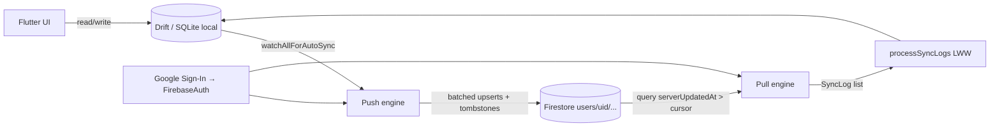

# Cashew – Cloud Database Sync: Feasibility & Step-by-Step Task Plan

Goal: every change a user makes (transactions, wallets, categories, budgets, goals, …) is persisted to a **cloud database**, instead of living only in the browser/device SQLite file (plus manual/Drive file backups).

This document is written so each **Task** (section 6) can be copied on its own into a new prompt. Each task lists its goal, the files involved, concrete instructions, and acceptance criteria.

> Analysis based on version `5.4.3+416`, DB schema `46`. Line numbers refer to the repo at the time of writing and may drift; use the symbol names.

---

## 1. Is it possible? – Short answer

**Yes, with one important constraint: SQLite (Drift) must stay as the local database. The cloud DB becomes the sync/persistence backend behind it.**

Why SQLite cannot simply be swapped for a cloud DB:

- `budget/lib/database/tables.dart` is ~7.7k lines. Most of it is Drift queries with joins, aggregates (`SUM`, `COUNT`, group-by-date, per-category totals) and reactive `watch()` streams that drive the whole UI. A NoSQL cloud DB such as Firestore has no joins or arbitrary aggregates, and rewriting that layer would be a full rewrite.
- The app must stay fast and usable offline.

So the realistic design is **local-first with cloud replication**:

```
UI ⇄ Drift/SQLite (source for all reads)  ⇄  Cloud sync engine  ⇄  Cloud DB (durable copy, multi-device)
```

### Why the current schema is already well suited to this

| Existing design feature | Where | Why it helps |
| --- | --- | --- |
| Client-generated UUID v4 primary keys | every table, `clientDefault(() => uuid.v4())` | No server-assigned IDs. A PK can be used directly as the cloud document ID. |
| `dateTimeModified` on every syncable table | `Wallets`, `Transactions`, `Categories`, `CategoryBudgetLimits`, `AssociatedTitles`, `Budgets`, `ScannerTemplates`, `Objectives`, `DeleteLogs` | Last-write-wins conflict resolution already exists. |
| `DeleteLogs` tombstones (`DeleteLogType`) | `tables.dart` ~L214, ~L239 | Deletes can be propagated. |
| `getAllNew*(DateTime lastSynced)` queries | `tables.dart` ~L2472–2665 | Ready-made "what changed since X" queries (push side). |
| `SyncLog` + `FinanceDatabase.processSyncLogs()` | `struct/syncClient.dart`, `tables.dart` ~L3601 | Ready-made, tested "apply remote changes with LWW" logic (pull side). **Reuse, do not rewrite.** |
| `watchAllForAutoSync()` | `tables.dart` ~L7383, consumed in `widgets/navigationFramework.dart` ~L461 | A hook that fires on any local change. |
| Generated `toJson()/fromJson()` on all row classes | `tables.g.dart` | Starting point for serialisation (see risks in T2). |
| Firebase Core, Auth, Firestore, Google Sign-In already installed and initialised | `pubspec.yaml`, `main.dart`, `struct/firebaseAuthGlobal.dart` | No new SDK needed for the recommended option. |

### What is wrong today (the gap this plan closes)

- Persistence is SQLite file only (`database/platform/native.dart`, `web.dart` → IndexedDB).
- "Cloud" today means **uploading whole `.sqlite` files** to Google Drive `appDataFolder` (`syncClient.dart`, `widgets/accountAndBackup.dart`). Every device uploads a full copy and downloads the others' full copies to diff them. That is heavy, not real-time, and the web version has a file-size problem (see the notes in `database/platform/web.dart`).
- Firestore is used **only** for shared budgets (`struct/shareBudget.dart`, top-level `budgets` collection).
- `firebase_options.dart` / `.firebaserc` point to the original author's Firebase project (`budget-app-flutter`). You cannot write to it, so you need your own project (Task 0.1).

---

## 2. Options considered

| Option | Fit with this codebase | Verdict |
| --- | --- | --- |
| **A. Cloud Firestore (per-user collections, incremental sync)** | SDK, Auth and Google Sign-In already present. Runs on Android, iOS and Web. UUID PKs map to doc IDs. Offline cache built in. Serverless. | **Recommended** |
| B. Supabase / Postgres | Relational schema maps 1:1 to the 9 tables and has row-level security. But it needs a new SDK, a bridge from Google Sign-In to Supabase Auth, and a SQL schema that must be kept in step with Drift migrations (v46+). | Good alternative if you prefer SQL. Same sync engine design applies. |
| C. Upload the SQLite file to S3/GCS/Azure (what Drive does now) | Smallest change, but keeps every problem of the current approach. | Not recommended |
| D. Replace Drift with a remote DB entirely | Rewrites ~7.7k lines of queries and loses offline use. | Not recommended |

**This plan implements Option A.** Section 7 notes what changes if you choose B.

---

## 3. Target architecture



### 3.1 Firestore data model

All under the signed-in user's UID so security rules are trivial:

```
users/{uid}/wallets/{walletPk}
users/{uid}/transactions/{transactionPk}
users/{uid}/categories/{categoryPk}
users/{uid}/budgets/{budgetPk}
users/{uid}/categoryBudgetLimits/{categoryLimitPk}
users/{uid}/associatedTitles/{associatedTitlePk}
users/{uid}/scannerTemplates/{scannerTemplatePk}
users/{uid}/objectives/{objectivePk}
users/{uid}/deleteLogs/{deleteLogPk}
users/{uid}/meta/sync            ← { schemaVersion, lastWriterClientId, ... }
users/{uid}/meta/settings        ← optional, Task 12
```

Each document = the row's JSON, plus three reserved fields:

| Field | Value | Purpose |
| --- | --- | --- |
| `_serverUpdatedAt` | `FieldValue.serverTimestamp()` | **Pull cursor.** Server clock, so device clock skew cannot make changes get missed. |
| `_clientId` | `clientID` from `struct/databaseGlobal.dart` | Lets a device skip its own echoes. |
| `_schemaVersion` | `schemaVersionGlobal` | Forward/backward compatibility (Task 15). |

Conflict resolution stays what it is today: **last-write-wins on the row's own `dateTimeModified`**, applied by the existing `processSyncLogs()`. The server timestamp is used only to find *what to download*, not to decide *who wins*.

### 3.2 Sync algorithm

- **Push:** on a local change (debounced), for each table run `getAllNew<Table>(lastPushedAt)` → upsert to Firestore in write batches of ≤ 500 → advance `lastPushedAt`. Do the same for `DeleteLogs`.
- **Pull:** for each collection, query `where('_serverUpdatedAt', isGreaterThan: cursor)` → map docs to `SyncLog` → `database.processSyncLogs(logs)` → advance the per-collection cursor.
- **First run on a device:** pull everything, then push everything (idempotent merge by LWW).
- Cursors (`lastPushedAt`, per-collection pull cursors) are kept in `SharedPreferences`, the same way `dateOfLastSyncedWithClient` is today.

---

## 4. Known risks and gotchas (read before starting)

1. **Serialisation round-trip is not guaranteed.** Generated `toJson()` uses Drift's default `ValueSerializer`. Columns with `TypeConverter`s (`Wallets.homePageWidgetDisplay`, `Budgets.budgetTransactionFilters`, `Budgets.walletFks`, `categoryFks`, `sharedMembers`, `Transactions.budgetFksExclude`, enum columns) and `DateTime` columns may not survive a JSON/Firestore round trip. Task 2 must prove this with tests before any other task builds on it.
2. **`dateTimeModified` is nullable and some bulk writes may skip it.** Examples: `updateBatchTransactionsOnly`, `moveWallet` / reorder helpers, migrations. Any row written without bumping `dateTimeModified` will never be pushed (and today never syncs either). Task 11 audits this.
3. **`withDefault(Constant(DateTime.now()))`** in the table definitions is evaluated once at class load, so it is not a reliable "now". Do not rely on it for sync timing.
4. **Echo loops.** A pull writes to SQLite, which triggers `watchAllForAutoSync()`, which would trigger a push. Rows pulled keep their remote `dateTimeModified` (older than `lastPushedAt`), so `getAllNew*` normally skips them. Task 11 adds an explicit guard anyway.
5. **Concurrency.** `runAllCloudFunctions`, the auto-sync listener and the existing Drive sync can overlap (`canSyncData`, `runningCloudFunctions`, `syncTimeoutTimer`). The new engine needs one mutex.
6. **Firestore limits and cost.** Batch ≤ 500 writes. Doc ≤ 1 MiB. Free tier is ~20k writes and 50k reads/day. A first sync of a large DB (tens of thousands of transactions) is many writes. Chunk and show progress (reuse `loadingProgressKey`).
7. **Foreign keys are not enforced across the network.** A transaction can arrive before its category. Drift/SQLite does not enforce FKs by default here, but `deleteWanderingTransactions()` (called after load in `navigationFramework.dart` ~L453) **deletes transactions whose category is missing**. Pull must complete all collections *before* that cleanup runs, and apply categories/wallets/objectives before transactions.
8. **Default data.** Onboarding creates default wallet/categories with fixed PKs (e.g. wallet `"0"`). Two fresh devices will both have them, and LWW merges them. Verify this does not produce duplicates (Task 10).
9. **Tombstone growth.** `DeleteLogs` never shrinks in normal use (`deleteAllDeleteLogs()` is only called from the debug page and preview-data generation). Optional TTL in Task 15.
10. **Shared budgets (`struct/shareBudget.dart`) already use a top-level Firestore `budgets` collection.** Leave it untouched. The new data lives under `users/{uid}/…` and the rules must keep both working.
11. **Secrets and config files.** `google-services*.json`, `firebase_options.dart`, and the web OAuth client ID in `web/index.html` all belong to the original project. iOS `GoogleService-Info.plist` is not committed. See Task 0.1.
12. **Privacy.** Financial data will be stored on a server. Rules must restrict each user to their own subtree. Consider documenting this to users, and consider client-side encryption as a future enhancement (out of scope here).

---

## 5. Task index and order

Do the tasks in order. Tasks within a phase that have no listed dependency can be done in parallel.

| # | Task | Type | Depends on |
| --- | --- | --- | --- |
| **Phase 0 – Prerequisites** | | | |
| 0.1 | Create your own Firebase project and re-point the app | Manual (you) | – |
| 0.2 | Confirm design decisions | Manual (you) | – |
| **Phase 1 – Foundation** | | | |
| 1 | Feature flag / setting for sync provider | Code | 0.2 |
| 2 | Row ⇄ Firestore serialisation layer + round-trip tests | Code | 0.2 |
| 3 | Firestore security rules, indexes, `firebase.json` | Config | 0.1 |
| 4 | Cloud sync auth/session helper | Code | 0.1 |
| **Phase 2 – Push (local → cloud)** | | | |
| 5 | Push engine for the 8 data tables | Code | 1, 2, 4 |
| 6 | Push delete tombstones | Code | 5 |
| 7 | Wire push to local changes | Code | 5, 6 |
| **Phase 3 – Pull (cloud → local)** | | | |
| 8 | Pull engine → `SyncLog` → `processSyncLogs` | Code | 2, 4 |
| 9 | Wire pull into `runAllCloudFunctions` | Code | 8 |
| 10 | First-time sync, new-device restore, default-data merge | Code | 7, 9 |
| **Phase 4 – Hardening and UX** | | | |
| 11 | Concurrency mutex, echo guard, `dateTimeModified` audit | Code | 7, 9 |
| 12 | (Optional) Sync user settings | Code | 10 |
| 13 | (Optional) Real-time listeners | Code | 9 |
| 14 | Settings UI, status, errors, translations | Code | 10 |
| 15 | Schema-version compatibility and tombstone cleanup | Code | 10 |
| 16 | Automated tests | Test | 5–10 |
| 17 | Disable Drive file-sync when cloud sync is active | Code | 10 |
| 18 | Sign-out, account switch, "delete my cloud data" | Code | 10 |
| 19 | Documentation update | Docs | all |

### How to hand a task to Bob

Use a prompt like this (replace the task number):

```
Read /CLOUD_SYNC_MIGRATION_PLAN.md (sections 1–4 for context) and implement Task <N> only.
Follow the instructions and acceptance criteria exactly. Do not start other tasks.
Run `flutter analyze` (and any tests you add) from /budget before reporting done.
```

Common validation for every code task (from `budget/`): `flutter pub get`, `dart run build_runner build --delete-conflicting-outputs` (only if tables/annotations changed), `flutter analyze`, `flutter test`.

---

## 6. Tasks

### Phase 0 – Prerequisites

#### Task 0.1 – Create your own Firebase project and re-point the app *(manual, you do this)*

The repo is wired to the original author's project (`budget-app-flutter`).

1. Create a Firebase project in the Firebase console.
2. Enable **Authentication → Sign-in method → Google**.
3. Create a **Cloud Firestore** database (production mode; pick a region close to your users). Rules are added in Task 3.
4. Register the Android, iOS and Web apps. For Android use applicationId `com.budget.tracker_app` (see `android/app/build.gradle`) unless you change it.
5. From `budget/`, run `dart pub global activate flutterfire_cli` then `flutterfire configure` to regenerate `lib/firebase_options.dart`.
6. Replace `android/app/google-services.json`. Add `ios/Runner/GoogleService-Info.plist`. Update `.firebaserc` (`"default"`) and `firebase.json` hosting target if you deploy the web build.
7. Replace the Google OAuth web client ID in `web/index.html` (`google-signin-client_id` meta tag).
8. In Google Cloud Console, enable the **Google Drive API** and **Gmail API** for the new project if you still want backups and email scanning. Add the Android SHA-1/SHA-256 fingerprints.
9. Confirm `signInGoogle()` (`widgets/accountAndBackup.dart`) and `firebaseGetDBInstance()` (`struct/firebaseAuthGlobal.dart`) still work on your project.

*Acceptance:* the app runs on your target platform, Google sign-in succeeds, and `FirebaseAuth.instance.currentUser` is non-null afterwards.

#### Task 0.2 – Confirm design decisions *(manual, you do this)*

Please confirm or change these defaults before coding starts:

| Decision | Default in this plan |
| --- | --- |
| Cloud DB | Cloud Firestore |
| Local DB | Stays Drift/SQLite (source of truth for reads) |
| Conflict policy | Last-write-wins on `dateTimeModified` (existing behaviour) |
| Auth | Existing Google Sign-In → Firebase Auth credential |
| Data scope | The 8 data tables plus `DeleteLogs`. Settings sync is optional (Task 12) |
| Drive file backups | Kept as manual backups. Drive *sync* is disabled when cloud sync is on (Task 17) |
| Attachments | Stay on Google Drive (`struct/uploadAttachment.dart`), unchanged |
| Encryption | Not in scope (data is protected by Firebase rules only) |

---

### Phase 1 – Foundation

#### Task 1 – Feature flag / setting for sync provider

**Goal:** a setting that selects the sync backend so the new code can ship dark and be rolled back.

**Files:** `budget/lib/struct/defaultPreferences.dart`, `budget/lib/struct/settings.dart` (read-only reference).

**Instructions**
1. Add default `"cloudSyncProvider": "drive"` (allowed values: `"drive"`, `"firestore"`) and `"cloudSyncEnabled": false` to the defaults map in `defaultPreferences.dart`. Defaults must exist or loading/importing settings will not back-fill them (see the `appStateSettings` notes in `TECHNICAL_README.md` §5.5).
2. Create `budget/lib/struct/cloudSync/cloudSyncConfig.dart` with helpers:
   - `bool isFirestoreSyncActive()` → `appStateSettings["cloudSyncProvider"] == "firestore" && appStateSettings["cloudSyncEnabled"] == true`.
   - Constants for the collection names listed in §3.1 and the reserved field names (`_serverUpdatedAt`, `_clientId`, `_schemaVersion`).
3. No behavioural change yet.

**Acceptance:** `flutter analyze` is clean. App behaves exactly as before. `isFirestoreSyncActive()` is false by default.

---

#### Task 2 – Row ⇄ Firestore serialisation layer + round-trip tests

**Goal:** a reliable, tested way to turn each Drift row class into a `Map<String, dynamic>` safe for Firestore and back.

**Files:** new `budget/lib/struct/cloudSync/cloudSerializer.dart`; new `budget/test/cloud_serializer_test.dart`; `budget/pubspec.yaml` (dev-dependencies); reference `budget/lib/database/tables.dart` and `tables.g.dart` (`toJson`/`fromJson` per class).

**Row classes:** `TransactionWallet`, `Transaction`, `TransactionCategory`, `Budget`, `CategoryBudgetLimit`, `TransactionAssociatedTitle`, `ScannerTemplate`, `Objective`, `DeleteLog`.

**Instructions**
1. Implement, for each of the 9 row classes: `Map<String, dynamic> toCloud(Row r)` and `Row fromCloud(Map<String, dynamic> m)`.
2. First try Option 1: use the generated `toJson/fromJson` with `ValueSerializer.defaults(serializeDateTimeValuesAsString: true)` so `DateTime` becomes an ISO string (timezone-safe and Firestore-friendly).
3. Where Option 1 fails the round-trip test (expected for columns with `TypeConverter`s: `homePageWidgetDisplay`, `budgetTransactionFilters`, and possibly enum lists), apply Option 2: store those columns through the table's converter. For example, use `$WalletsTable.$converterhomePageWidgetDisplayn.toSql(...)` / `.fromSql(...)` to hold a string.
4. Handle missing keys on read. A doc written by an older client may lack newer columns. Nullable columns must default to null. Non-nullable columns with a SQL default must get that default instead of throwing.
5. Do **not** include the reserved `_` fields in `toCloud`. The push engine adds them.
6. Add `fake_cloud_firestore` and `mockito`/`flutter_test` as `dev_dependencies` only if needed.
7. Tests: for each class, build an instance with every field populated (including non-null values for all nullable columns and non-empty lists), and another with all nullable fields null. Assert `fromCloud(toCloud(x)) == x`. Also assert `toCloud` output contains only types Firestore accepts (`String`, `num`, `bool`, `null`, `List`, `Map`).

**Acceptance:** `flutter test test/cloud_serializer_test.dart` passes for all 9 classes. No `DateTime` or enum objects leak into the map.

---

#### Task 3 – Firestore security rules, indexes and `firebase.json`

**Goal:** a user can read and write only their own subtree, and the existing shared-budget feature keeps working.

**Files:** new `budget/firestore.rules`, new `budget/firestore.indexes.json`, edit `budget/firebase.json`.

**Instructions**
1. `firestore.rules`:
   - `match /users/{uid}/{document=**}` → `allow read, write: if request.auth != null && request.auth.uid == uid;`
   - Keep a rule for the existing top-level `budgets` collection (and its `transactions` sub-collection). Reproduce the current behaviour used in `shareBudget.dart`: owner by `owner == request.auth.uid`, members by `request.auth.token.email in resource.data.members`. **Check the current rules in the Firebase console of the project first**, and copy them rather than guessing.
   - Deny everything else.
2. `firestore.indexes.json`: single-field `_serverUpdatedAt` ascending is automatic. Add composite indexes only if a later task needs them.
3. Register `firestore` in `firebase.json` (`"firestore": {"rules": "firestore.rules", "indexes": "firestore.indexes.json"}`) without breaking the existing `hosting` section.
4. Optional: add a rules test with the Firebase emulator (`firebase emulators:start --only firestore`).

**Acceptance:** `firebase deploy --only firestore:rules` succeeds. Manual check: user A cannot read `users/<B>/transactions/x`. Shared budgets still work.

---

#### Task 4 – Cloud sync auth/session helper

**Goal:** one function that returns an authenticated `FirebaseFirestore` and the current `uid`, reusing the existing sign-in flow.

**Files:** new `budget/lib/struct/cloudSync/cloudSyncSession.dart`; reference `struct/firebaseAuthGlobal.dart` (`firebaseGetDBInstance`), `widgets/accountAndBackup.dart` (`signInGoogle`, `googleUser`).

**Instructions**
1. Implement `Future<CloudSyncSession?> getCloudSyncSession()` returning `{FirebaseFirestore db, String uid, DocumentReference userRoot}` where `userRoot = db.collection('users').doc(uid)`. Return null if the user is not signed in or sign-in fails. Do not throw.
2. Call `firebaseGetDBInstance()` internally. Do not duplicate credential logic.
3. On web, enable Firestore persistence explicitly (`FirebaseFirestore.instance.settings = const Settings(persistenceEnabled: true)`). On mobile it is on by default. Do this once, guarded by a static flag.
4. Provide helper `CollectionReference<Map<String, dynamic>> collectionFor(CloudTable t)` using constants from Task 1.

**Acceptance:** with a signed-in user, `getCloudSyncSession()` returns a non-null session. Signed out → null with no exception. `flutter analyze` is clean.

---

### Phase 2 – Push (local → cloud)

#### Task 5 – Push engine for the 8 data tables

**Goal:** upload every row changed since the last push.

**Files:** new `budget/lib/struct/cloudSync/cloudPush.dart`; use `FinanceDatabase.getAllNewWallets/Categories/Budgets/CategoryBudgetLimits/Transactions/AssociatedTitles/ScannerTemplates/Objectives` (`tables.dart` ~L2472–2584), the serializer from Task 2, and the session from Task 4.

**Instructions**
1. Add `Future<bool> pushLocalChangesToCloud()` (guard with `isFirestoreSyncActive()`).
2. Read `lastPushedAt` from `SharedPreferences` (`"cloudLastPushedAt"`, default `DateTime(0)`).
3. Record `pushStarted = DateTime.now()` **before** querying.
4. For each table, in dependency order (wallets, categories, objectives, budgets, categoryBudgetLimits, associatedTitles, scannerTemplates, transactions): fetch `getAllNew…(lastPushedAt)`, serialise, and write with `WriteBatch.set(docRef, {...data, '_serverUpdatedAt': FieldValue.serverTimestamp(), '_clientId': clientID, '_schemaVersion': schemaVersionGlobal})`. Use `SetOptions(merge: false)`, because the whole row is authoritative and nulls must overwrite.
5. Chunk batches at 400 ops (headroom under the 500 limit). Update `loadingProgressKey` as progress for large pushes.
6. Only after **all** batches succeed, save `cloudLastPushedAt = pushStarted`. On any failure leave the cursor unchanged (re-push is idempotent) and return false.
7. Doc ID = the row's primary key string.

**Acceptance:** adding a transaction locally and calling `pushLocalChangesToCloud()` creates `users/<uid>/transactions/<pk>` with the expected fields, and a second call with no changes performs zero writes. Covered by a unit test using `fake_cloud_firestore`, or a manual emulator check.

---

#### Task 6 – Push delete tombstones

**Goal:** propagate deletions.

**Files:** extend `cloudPush.dart`; use `getAllNewDeleteLogs(DateTime)` (`tables.dart` ~L2660).

**Instructions**
1. In `pushLocalChangesToCloud()`, also push `DeleteLogs` newer than `cloudLastPushedAt` to `users/<uid>/deleteLogs/<deleteLogPk>` (same reserved fields).
2. Also **delete the actual document** from the data collection (map `DeleteLogType` → collection; skip `Unused`). Deleting is optional but keeps the cloud from re-sending dead rows to new devices. If you keep dead docs, the tombstone still wins on pull because of `processSyncLogs`. Choose delete-doc and say so in a code comment.
3. Do this in the same batch flow and cursor handling as Task 5.

**Acceptance:** deleting a transaction locally and pushing results in a tombstone doc and the transaction doc being removed.

---

#### Task 7 – Wire push to local changes

**Goal:** changes are uploaded automatically after the user edits data.

**Files:** `budget/lib/widgets/navigationFramework.dart` (the `database.watchAllForAutoSync().listen(...)` block, ~L461), `budget/lib/struct/syncClient.dart` (`createSyncBackup`, `backupDebounce`, `Debouncer` from `widgets/util/debouncer.dart`).

**Instructions**
1. Inside the existing listener, if `isFirestoreSyncActive()`, call a debounced `pushLocalChangesToCloud()` (3–5 s debounce; reuse `Debouncer`). Otherwise keep the current `createSyncBackup(changeMadeSync: true)` behaviour.
2. Respect `runningCloudFunctions` like the current code does, so a pull in progress does not trigger pushes.
3. Show the same subtle loading indicator style (`loadingIndeterminateKey`) only for long pushes (> ~1 s).
4. Do not remove the Drive code path (Task 17 handles that).

**Acceptance:** with the flag on, creating or editing a transaction results in the cloud doc within a few seconds, with no Drive upload happening.

---

### Phase 3 – Pull (cloud → local)

#### Task 8 – Pull engine → `SyncLog` → `processSyncLogs`

**Goal:** download changes made on other devices and merge them with the existing LWW logic.

**Files:** new `budget/lib/struct/cloudSync/cloudPull.dart`; reuse `SyncLog` (`struct/syncClient.dart`), `UpdateLogType`, `DeleteLogType` (`tables.dart`), and `FinanceDatabase.processSyncLogs()` (`tables.dart` ~L3601).

**Instructions**
1. Add `Future<bool> pullCloudChanges()` (guard with `isFirestoreSyncActive()`).
2. For each of the 9 collections keep a cursor in `SharedPreferences` (`"cloudPullCursor_<collection>"`, a Firestore `Timestamp` serialised as ISO string, default epoch).
3. Query `collection.where('_serverUpdatedAt', isGreaterThan: cursor).orderBy('_serverUpdatedAt').limit(500)` and loop until a page returns fewer than 500 docs. Skip docs whose `_clientId == clientID` (own echoes). **Still advance the cursor past them.**
4. Convert each doc with `fromCloud` (Task 2) into `SyncLog(updateLogType: …, pk: …, itemToUpdate: row, transactionDateTime: row.dateTimeModified ?? DateTime(0))`. For `deleteLogs` docs build `SyncLog(deleteLogType: …, pk: entryPk, transactionDateTime: dateTimeModified)`, exactly like `syncClient.dart` ~L467–477.
5. Call `database.processSyncLogs(allLogs)` **once** after all collections are fetched, so deletes and updates are ordered by time across tables (the function sorts by `transactionDateTime`). Also write the received `DeleteLog` rows themselves into the local `deleteLogs` table, so this device can forward them if needed.
6. Only after `processSyncLogs` succeeds, persist the new cursors.
7. After applying, repeat what `_syncData` does at the end (`syncClient.dart` ~L523–536): verify `selectedWalletPk` still exists, otherwise `setPrimaryWallet(...)`. Update `lastSynced`.
8. Memory: if the total is large, process per collection page rather than holding everything in memory, but keep time ordering within a page.

**Acceptance:** after device A pushes a new transaction, device B calling `pullCloudChanges()` shows it. After A deletes it and pushes, B's pull removes it. An older remote copy never overwrites a newer local row (LWW test).

---

#### Task 9 – Wire pull into `runAllCloudFunctions`

**Goal:** pull runs on app start and on pull-to-refresh.

**Files:** `budget/lib/widgets/navigationFramework.dart` (`runAllCloudFunctions`, ~L305).

**Instructions**
1. Right after `await syncData(context);`, add `if (isFirestoreSyncActive()) { await pullCloudChanges(); await pushLocalChangesToCloud(); }`.
2. `syncData()` must be a no-op when Firestore sync is active (do the gating in Task 17 if you prefer, but it must not run both).
3. Keep the order: the pull must complete **before** `markSubscriptionsAsPaid` and `deleteWanderingTransactions` (already after `runAllCloudFunctions` in the load sequence, ~L436–455; verify it stays that way. See Risk 7).
4. Errors: catch inside the new calls, log, and let the existing `catch` in `runAllCloudFunctions` handle auth errors.

**Acceptance:** launching the app on a second device with the flag on loads the first device's data, and pull-to-refresh fetches new remote changes.

---

#### Task 10 – First-time sync, new-device restore, default-data merge

**Goal:** turning cloud sync on for the first time (or on a fresh install) never loses or duplicates data.

**Files:** new `budget/lib/struct/cloudSync/cloudInitialSync.dart`; read `database/initializeDefaultDatabase.dart`, `pages/onBoardingPage.dart`.

**Instructions**
1. Implement `Future<void> runInitialCloudSync()`, called when cloud sync is enabled and `cloudInitialSyncDone != true`:
   - Pull everything (cursors at epoch).
   - Then reset `cloudLastPushedAt` to epoch and push everything (the cloud receives local-only rows, and LWW already handled the overlap).
   - Set `cloudInitialSyncDone = true` (add it to `defaultPreferences.dart`).
2. Handle three scenarios and add a short comment or test for each: (a) cloud empty + local has data → upload only; (b) cloud has data + local is a fresh install with only default rows → default rows must not create duplicates (default categories/wallet have fixed PKs, so they should merge by PK; verify and document the result); (c) both have different data → union.
3. Show progress via `loadingProgressKey` and a final snackbar.
4. If the fresh install's default rows have a newer `dateTimeModified` than the cloud's customised copies, LWW would overwrite the user's customised categories/wallet. Prevent this: on a brand-new install where cloud data exists, **pull first and skip creating defaults**, or set the default rows' `dateTimeModified` to epoch before the merge.

**Acceptance:** scenario (b) leaves exactly one copy of each default category and the user's customised names intact. Scenario (c) results in the union of both datasets.

---

### Phase 4 – Hardening and UX

#### Task 11 – Concurrency mutex, echo guard, `dateTimeModified` audit

**Goal:** make sync robust.

**Files:** new `budget/lib/struct/cloudSync/cloudSyncLock.dart`; edits to `cloudPush.dart`, `cloudPull.dart`; audit `database/tables.dart`.

**Instructions**
1. Add a single async mutex (`Future`-chain or `package:async` `Lock`-like) so push, pull and initial sync never run concurrently. Concurrent triggers coalesce into one follow-up run.
2. Add an `isApplyingCloudChanges` flag set during `processSyncLogs`. Make the auto-push listener ignore events while it is true (Risk 4).
3. **Audit** every write path in `tables.dart` that touches the 8 synced tables without setting `dateTimeModified`. Start with `updateBatchTransactionsOnly`, `createBatchTransactionsOnly`, `createBatchAssociatedTitlesOnly`, `moveWallet`, any `batch.update`/`customStatement` that reorders (`order` columns), `fixOrderAssociatedTitles`, and migrations. For each, either set `dateTimeModified: Value(DateTime.now())` or document why it is intentionally skipped. List findings in the PR description.
4. Do not change business logic beyond adding the timestamp.

**Acceptance:** rapid edits produce no overlapping syncs. A reorder (drag wallets, categories or associated titles) on device A appears on device B after a sync. The audit list is delivered.

---

#### Task 12 – (Optional) Sync user settings

**Goal:** settings follow the user across devices.

**Files:** `struct/settings.dart` (`backupSettings`, `AppSettings` table), `struct/defaultPreferences.dart`; new `cloudSync/cloudSettings.dart`.

**Instructions**
1. Push the `userSettings` JSON to `users/<uid>/meta/settings` (`{json, dateUpdated, _clientId}`) after `updateSettings(...)` changes, debounced.
2. On pull, apply only if the remote `dateUpdated` is newer, and **exclude device-specific keys** (notification IDs, `selectedWalletPk` if it is not desired, biometrics, `cachedCurrencyExchange`, `hasSignedIn`, `cloudSync*`, `lastSynced`, `dateOfLastSyncedWithClient`, etc.). Define the exclusion list in one constant.
3. Reuse the existing import path that back-fills missing keys (`initializeSettings`) rather than re-implementing it.

**Acceptance:** changing the theme on device A reaches device B. Device-specific keys are not overwritten.

---

#### Task 13 – (Optional) Real-time listeners

**Goal:** near-instant updates between devices without pull-to-refresh.

**Files:** `cloudPull.dart`, `navigationFramework.dart`.

**Instructions**
1. After the initial pull, attach `snapshots()` listeners on each collection with `where('_serverUpdatedAt', isGreaterThan: cursor)`, feeding the same conversion + `processSyncLogs` path under the mutex from Task 11. Debounce batches (≈ 500 ms).
2. Cancel the listeners on sign-out, when the flag is turned off, and when the app is backgrounded (use `OnAppResume` in `main.dart`).
3. Add a setting `"cloudSyncRealtime"` (default false).

**Acceptance:** with two devices open, an edit on one appears on the other within a few seconds. No duplicate processing of the same doc.

---

#### Task 14 – Settings UI, status, errors, translations

**Goal:** users can turn it on, see status, and understand failures.

**Files:** `widgets/accountAndBackup.dart` (existing backup/sync settings UI around L818–950), `assets/translations/translations.csv` + generated JSON (see `TECHNICAL_README.md` §9), `widgets/settingsContainers.dart` (reuse existing toggle widgets).

**Instructions**
1. Add a "Cloud database sync" section: toggle (sets `cloudSyncProvider="firestore"` and `cloudSyncEnabled`, then runs `runInitialCloudSync()`), "Last synced" time, "Sync now" button (calls `runAllCloudFunctions`), and the signed-in account.
2. Require Google sign-in first (reuse `signInGoogle`).
3. Show a clear error popup/snackbar for permission-denied, offline, and quota-exceeded Firestore errors (`FirebaseException.code`).
4. Add new strings via the translation workflow. Use `"key".tr()` with `en` entries at minimum.
5. Add a short privacy notice on enable.

**Acceptance:** toggling on triggers the initial sync with visible progress. Failures surface readable messages.

---

#### Task 15 – Schema-version compatibility and tombstone cleanup

**Goal:** an old app version must not corrupt or crash on newer cloud data, and the cloud must not grow forever.

**Files:** `cloudPull.dart`, `cloudPush.dart`, new `cloudMaintenance.dart`.

**Instructions**
1. Write `users/<uid>/meta/sync.schemaVersion = max(existing, schemaVersionGlobal)` on push.
2. On pull, if `meta/sync.schemaVersion > schemaVersionGlobal`, stop pulling and show "Update the app to keep syncing" (do not apply unknown rows). Rows with `_schemaVersion` greater than the local version are skipped, not partially applied.
3. When you later bump `schemaVersionGlobal` (see `TECHNICAL_README.md` §5.4), add a checklist item in this doc: update `cloudSerializer.dart` for the new column.
4. Tombstone cleanup: a maintenance function that deletes `deleteLogs` docs older than N days (default 90) **only** when every known client has pulled past them (track `lastPulledAt` per `_clientId` under `meta/clients/{clientId}`), or just use the conservative fixed 180-day TTL. Run it at most once a day.

**Acceptance:** simulated higher `_schemaVersion` doc is skipped with a user-visible message. Old tombstones are pruned without resurrecting deleted rows on a device that was offline for less than the TTL.

---

#### Task 16 – Automated tests

**Goal:** protect the sync logic from regressions (the repo currently has effectively no tests; see `TECHNICAL_README.md` §11).

**Files:** `budget/test/…`, `pubspec.yaml` dev-dependencies (`fake_cloud_firestore`, and an in-memory Drift DB via `NativeDatabase.memory()`).

**Instructions** (use two in-memory `FinanceDatabase` instances to represent two devices sharing one `FakeFirebaseFirestore`)
1. Push then pull: create, update and delete a transaction on A and see the result on B.
2. LWW: an older remote edit never overwrites a newer local row, and a newer one does.
3. Delete beats a stale update (tombstone newer than the row's `dateTimeModified`).
4. Initial sync scenarios (a), (b), (c) from Task 10.
5. Pagination: > 500 docs pulled correctly. > 400 rows pushed in multiple batches.
6. Cursor not advanced when a batch fails.
7. Own-echo skip by `_clientId`.

**Acceptance:** `flutter test` is green. Tests run without network or a real Firebase project.

---

#### Task 17 – Disable Drive file-sync when cloud sync is active

**Goal:** never run both sync mechanisms at once.

**Files:** `struct/syncClient.dart` (`createSyncBackup`, `_syncData`), `widgets/accountAndBackup.dart` (`createBackupInBackground`, backup UI).

**Instructions**
1. At the top of `createSyncBackup` and `_syncData`: `if (isFirestoreSyncActive()) return false;`.
2. Keep **manual and automatic full backups** (`createBackup` without `clientIDForSync`, `exportDB.dart`, `importDB.dart`) working. They are independent safety nets.
3. In the settings UI hide or disable the "sync with other devices" Drive controls when Firestore sync is active, with an explanatory subtitle.
4. Restoring a backup (`loadBackup` / `overwriteDefaultDB`, which resets `dateOfLastSyncedWithClient`) must also reset the cloud cursors and trigger a full push, so the restored state becomes the cloud state. Decide and document (a) restored DB wins (push everything with fresh `dateTimeModified`) or (b) merge. Default to (b) merge, which is less destructive.

**Acceptance:** with the flag on, no files are written to Drive `appDataFolder` by the sync path. Manual backup and restore still work.

---

#### Task 18 – Sign-out, account switch, "delete my cloud data"

**Goal:** no cross-account leakage, and users can erase the cloud copy.

**Files:** `widgets/accountAndBackup.dart` (`signOutGoogle`, ~L229), `cloudSync/*`.

**Instructions**
1. On sign-out: cancel listeners (Task 13) and stop auto-push. Keep local data.
2. On sign-in with a **different** Google account than the one that last synced (store `cloudSyncUid`), ask the user: merge local data into the new account, or clear local data first. Never silently merge two accounts' data.
3. Add "Delete cloud data": batch-delete all docs under `users/<uid>/…` (paginated, 400 per batch), reset `cloudInitialSyncDone`, cursors and `cloudLastPushedAt`. Confirm with a popup (`widgets/openPopup.dart`).

**Acceptance:** switching accounts prompts. After "Delete cloud data" the Firestore console shows an empty `users/<uid>` subtree and the local data is untouched.

---

#### Task 19 – Documentation update

**Files:** `TECHNICAL_README.md` (§5, §6), this file.

**Instructions:** update the architecture diagram in §6 (Firestore user sync), describe the collections, cursors and settings keys, list the new files under `struct/cloudSync/`, and add "when you add or change a table column, update `cloudSerializer.dart`, bump nothing else" to the Contribution Notes. Mark completed tasks in section 5 of this file.

---

## 7. If you choose Supabase/Postgres instead (Option B)

The sync algorithm, Tasks 1, 4–11 and 14–19 keep the same shape. What changes:

- Task 0.1: create a Supabase project, enable Google provider, add `supabase_flutter`.
- Task 2: map rows to Postgres columns (snake_case) rather than documents. Create the tables with `user_id uuid default auth.uid()` plus `server_updated_at timestamptz default now()` maintained by a trigger.
- Task 3: Row Level Security policies (`user_id = auth.uid()`) instead of Firestore rules.
- Tasks 5–6: `upsert` in chunks. Deletes via tombstone rows.
- Task 8: pull with `.gt('server_updated_at', cursor).order('server_updated_at')`.
- Extra task: a migration process so the Postgres schema follows each Drift `schemaVersion` bump.

---

## 8. Rough effort

| Phase | Tasks | Estimate |
| --- | --- | --- |
| 0 | 0.1–0.2 | 0.5–1 day (manual) |
| 1 | 1–4 | 2–3 days |
| 2 | 5–7 | 2–3 days |
| 3 | 8–10 | 3–5 days |
| 4 | 11, 14–19 (12 and 13 optional) | 5–8 days |

Core working sync (Phases 0–3) is roughly 1.5–2 weeks. Production-ready (Phase 4) is roughly 3 weeks of focused work.
