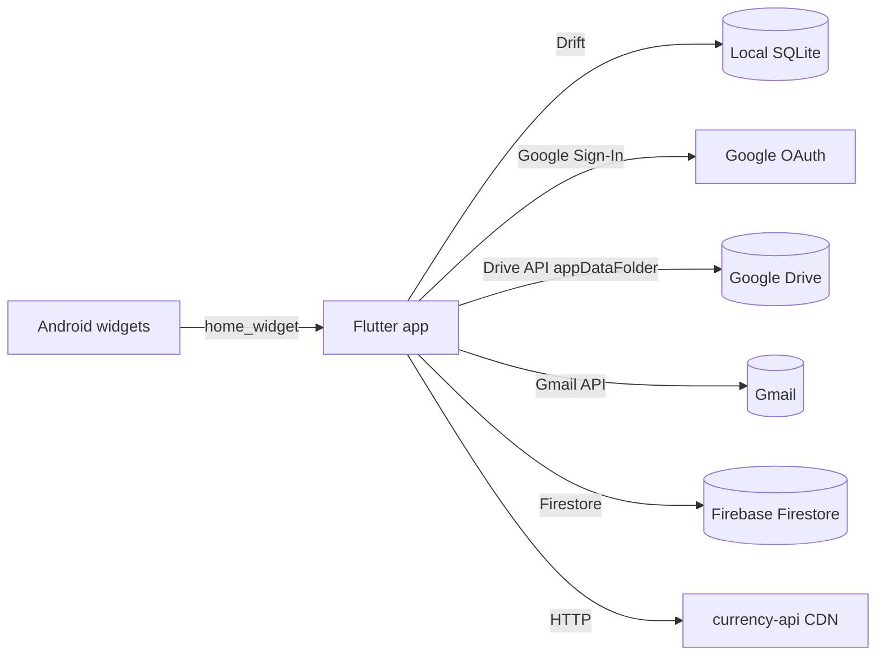

# Cashew – Technical Documentation

Engineering-oriented overview of the Cashew codebase. For product features, store links and release notes see the main [`README.md`](README.md).

> Generated from a static scan of the repository (version `5.4.3+416`, DB schema `46`). Items marked **Observation** are things noticed during the scan that may be worth following up.

---

## 1. Overview

Cashew is a cross-platform personal finance / budget tracker.

| Aspect | Detail |
| --- | --- |
| Framework | Flutter (Dart SDK `>= 3.0.0`), Material 3 / Material You |
| Targets | Android, iOS, Web (PWA, hosted on Firebase Hosting). Android home-screen widgets in Kotlin |
| Local storage | SQLite via [Drift](https://drift.simonbinder.eu/) (`sqlite3_flutter_libs` on native, `sql-wasm` on web) |
| Settings | `shared_preferences` JSON blob (`userSettings`), mirrored into the DB `AppSettings` table for backup |
| Cloud | Firebase (Core, Auth, Firestore), Google Sign-In, Google Drive (`appDataFolder`), Gmail API |
| i18n | `easy_localization`, JSON files generated from a Google Sheet |
| State | Plain `StatefulWidget`s + global `GlobalKey`s + Drift `Stream`s + `provider` for a few notifiers |
| Size | ~212 Dart files, ~120k lines under `budget/lib` (`tables.dart` alone is ~7.7k lines) |
| License | GPL-3.0 (see [`LICENSE`](LICENSE)) |

---

## 2. Repository Layout

```
Cashew/
├── README.md                  Product-facing README
├── TECHNICAL_README.md        This file
├── LICENSE                    GPL-3.0
├── promotional/               Store badges, screenshots, icons (not used by the app)
├── scripts/                   Windows .bat helpers (build/deploy, translations)
├── .github/
│   ├── ISSUE_TEMPLATE/        bug / feature / question
│   └── workflows/firebase-hosting-pull-request.yml
├── .vscode/launch.json        Flutter launch config (web port 5000)
└── budget/                    ← the Flutter project (run all flutter/dart commands here)
    ├── pubspec.yaml
    ├── firebase.json, .firebaserc
    ├── analysis_options.yaml
    ├── lib/                   Application source (see §3)
    ├── assets/
    │   ├── categories/        Category icon PNGs
    │   ├── fonts/, icons/, icon/, images/, landing/
    │   ├── static/            currencies.json, countries.json, language-names.json, generated/
    │   └── translations/      translations.csv, generate-translations.py, generated/*.json
    ├── drift_schemas/         Exported schema snapshots v33 … v46 (JSON)
    ├── packages/              Vendored/modified third-party packages
    │   ├── sliding_sheet-0.5.2-modified/
    │   └── implicitly_animated_reorderable_list-0.4.2-modified/
    ├── android/               Gradle project, Kotlin widget providers, widget layouts
    ├── ios/                   Xcode project, Podfile
    ├── web/                   index.html, manifest, sql-wasm.js/.wasm, worker
    └── test/widget_test.dart  Placeholder only (see §11)
```

---

## 3. Source Structure (`budget/lib`)

| Path | Responsibility |
| --- | --- |
| [`main.dart`](budget/lib/main.dart) | Entry point, bootstrap sequence, `MaterialApp`, wrapper widget chain |
| [`functions.dart`](budget/lib/functions.dart) | Cross-cutting helpers: `getPlatform()`, `pushRoute()`, formatting, etc. |
| [`colors.dart`](budget/lib/colors.dart) | Theme construction (light/dark), colour helpers |
| `firebase_options.dart` | FlutterFire generated config |
| `database/` | Drift tables, queries, migrations, platform-specific DB opening, default/preview data |
| `struct/` | "Business logic" and app services (sync, shared budgets, currency, notifications, settings, biometrics…) |
| `struct/cloudSync/` | Cloud Database Sync engine (Firestore persistence, push/pull, serialization, LWW, mutex lock) |
| `pages/` | Full-screen pages (≈45 files + `homePage/` with the dashboard sections) |
| `widgets/` | Reusable UI components (≈110 files), plus `framework/` (page/popup scaffolds), `transactionEntry/`, `util/` |
| `modified/reorderable_list.dart` | Locally modified Flutter reorderable list |

### Notable `struct/` modules

| File | Purpose |
| --- | --- |
| `databaseGlobal.dart` | Globals: `database`, `sharedPreferences`, `clientID`, `uuid` |
| `cloudSync/cloudSyncConfig.dart` | Firestore collection/field names, `CloudTable` enum, `isFirestoreSyncActive()` |
| `cloudSync/cloudSerializer.dart` | Drift ⇄ Firestore map serializer with round-trip type safety |
| `cloudSync/cloudSyncSession.dart` | Authenticated session wrapper with web persistence |
| `cloudSync/cloudSyncLock.dart` | Async mutex lock and echo prevention flag (`isApplyingCloudChanges`) |
| `cloudSync/cloudPush.dart` | Incremental change push engine (batches <= 400 writes) |
| `cloudSync/cloudPull.dart` | Incremental pull engine mapping remote changes into `SyncLog` (LWW) |
| `cloudSync/cloudInitialSync.dart` | Two-way initial merge for first-time sync activation |
| `cloudSync/cloudMaintenance.dart` | Old tombstone cleanup and user cloud data wipe |
| `settings.dart` / `defaultPreferences.dart` | `appStateSettings` map, load/save/migrate user settings; restores settings from a DB import |
| `syncClient.dart` | Device-to-device sync using per-device backup files in Google Drive `appDataFolder` |
| `shareBudget.dart` | Shared budgets via Firestore (`budgets` collection), pending-queue upload, member management |
| `currencyFunctions.dart` | Exchange-rate fetch (`@fawazahmed0/currency-api` via jsDelivr) and conversion ratios |
| `upcomingTransactionsFunctions.dart` | Subscription/upcoming/credit/debt logic: create next occurrence, mark paid/skipped |
| `initializeNotifications.dart`, `notificationsGlobal.dart` | Local notifications (daily reminder, upcoming bills), payload routing |
| `initializeBiometrics.dart` | Biometric app lock (`local_auth`) |
| `quickActions.dart` | Launcher shortcut actions |
| `spendingSummaryHelper.dart` | Aggregation helpers used by charts/summary widgets |
| `logging.dart` | `captureLogs()` wrapper; optional logging controlled by the `logging` setting |

---

## 4. Application Bootstrap

`main()` (in [`main.dart`](budget/lib/main.dart)) runs inside `captureLogs(...)` and initialises, in order:

1. `WidgetsFlutterBinding.ensureInitialized()`
2. `Firebase.initializeApp(DefaultFirebaseOptions.currentPlatform)`
3. `EasyLocalization.ensureInitialized()`
4. `sharedPreferences = SharedPreferences.getInstance()`
5. `database = await constructDb('db')` (platform-conditional, see §5.3)
6. `initializeNotifications()` → stores launch `notificationPayload`
7. `loadCurrencyJSON()`, `loadLanguageNamesJSON()`
8. `initializeSettings()` (loads/migrates settings; handles "database just imported" restore)
9. Timezone init (`timezone` + `flutter_timezone`)
10. `setHighRefreshRate()` (Android)
11. `runApp(DevicePreview → InitializeLocalizations → RestartApp → InitializeApp)`

### Widget wrapper chain (inside `MaterialApp.builder`)

```
OnAppResume
 └ InitializeBiometrics
    └ InitializeNotificationService
       └ InitializeAppLinks
          └ WatchForDayChange
             └ WatchSelectedWalletPk
                └ WatchAllWallets
                   └ <Navigator/home>
```

`home` is a `Stack` containing `NavigationSidebar` (wide layouts), `InitialPageRouteNavigator` (onboarding vs. main app), `GlobalSnackbar`, `GlobalLoadingIndeterminate` and `GlobalLoadingProgress`. On web the tree is wrapped in a `FadeIn`. In release mode `ErrorWidget.builder` is replaced with an empty container.

Debug flags at the top of `main.dart`: `enableDevicePreview`, `allowDebugFlags`, `allowDangerousDebugFlags`.

---

## 5. Data Layer

### 5.1 Schema (Drift, `database/tables.dart`)

`FinanceDatabase` is declared with these tables (current `schemaVersionGlobal = 46`):

| Table | Purpose / key columns |
| --- | --- |
| `Wallets` | Accounts (UI name) – `walletPk`, `currency`, `currencyFormat`, `decimals`, `order`, `homePageWidgetDisplay` |
| `Transactions` | `transactionPk`, `amount`, `categoryFk`, `subCategoryFk`, `walletFk`, `income`, `type` (`TransactionSpecialType`), recurrence fields (`periodLength`, `reoccurrence`, `endDate`), `paid`/`skipPaid`, `pairedTransactionFk` (transfers), `objectiveFk`, `objectiveLoanFk`, `budgetFksExclude`, sharing fields (`sharedKey`, `sharedStatus`, `transactionOwnerEmail`…), `methodAdded` |
| `Categories` | Category definition, icon/emoji, colour, main vs. sub-category, `income` default |
| `CategoryBudgetLimits` | Per-budget category spending limits |
| `AssociatedTitles` | Title → category auto-assign memory |
| `Budgets` | Amount, period (`BudgetReoccurence`), `walletFks`, `categoryFks(+Exclude)`, `budgetTransactionFilters`, `memberTransactionFilters`, pinned/archived, sharing fields |
| `Objectives` | Goals and loans (`ObjectiveType.goal/loan`) |
| `ScannerTemplates` | Templates for parsing Gmail/notification messages into transactions |
| `AppSettings` | Single-row JSON backup of user settings (travels with DB export) |
| `DeleteLogs` | Tombstones (`entryPk`, `type`, `dateTimeModified`) used for sync deletes |

Conventions:
- Primary keys are client-generated UUID v4 strings (`clientDefault(() => uuid.v4())`) so rows can be merged across devices.
- Every syncable row has `dateTimeModified`; sync is last-write-wins on this column.
- List-valued columns use `TypeConverter`s that serialise to strings (`StringListInColumnConverter`, `IntListInColumnConverter`, `DoubleListInColumnConverter`, `BudgetTransactionFiltersListInColumnConverter`, `HomePageWidgetDisplayListInColumnConverter`).
- Limits: `NAME_LIMIT=250`, `NOTE_LIMIT=500`, `COLOUR_LIMIT=50`.
- Query helpers (`getAllTransactions…`, totals, streams) live inside `FinanceDatabase` in `tables.dart`; result DTOs (`TransactionWithCategory`, `CategoryWithTotal`, `AllWallets`, `TotalWithCount`, …) are declared in the same file.

### 5.2 Naming mismatches (important)

- UI **Accounts** = code/DB **Wallets**
- UI **Goals** = code/DB **Objectives**

### 5.3 Platform-specific DB opening

`database/platform/shared.dart` uses conditional exports:

```dart
export 'unsupported.dart'
    if (dart.library.ffi) 'native.dart'
    if (dart.library.html) 'web.dart';
```

- **native.dart** – `LazyDatabase` → `MultiExecutor(read: NativeDatabase(file), write: NativeDatabase.createInBackground(file))`, file `db.sqlite` in the app documents directory. Also exposes `getCurrentDBFileInfo()` and `overwriteDefaultDB()` (used by import; resets `dateOfLastSyncedWithClient`).
- **web.dart** – `drift/web` `WebDatabase` with IndexedDB storage (or `InMemoryWebStorage` when initial bytes are supplied, e.g. import), using `web/sql-wasm.js`.

Always use `getPlatform()` from `functions.dart` instead of `dart:io` `Platform` (not available on web).

### 5.4 Migrations

Migrations are written as cumulative `if (from <= N)` blocks in `FinanceDatabase.migration.onUpgrade`, with schema snapshots under `budget/drift_schemas/` (v33–v46) and generated step helpers in `database/schema_versions.dart`.

Procedure (from the main README, run from `budget/`):

```bash
# 1. edit tables, bump schemaVersionGlobal in lib/database/tables.dart
dart run build_runner build
dart run drift_dev schema dump lib/database/tables.dart drift_schemas/drift_schema_v<NEW>.json
dart run drift_dev schema steps drift_schemas/ lib/database/schema_versions.dart
# 2. add the migration logic in onUpgrade
```

> **Observation:** the main README says to wire `await stepByStep(...)` into `tables.dart`. `stepByStep` is generated in `schema_versions.dart`, but `tables.dart` does not call it – migrations currently use manual `from <= N` blocks. The README step appears outdated.

### 5.5 Settings

`appStateSettings` (`Map<String, dynamic>`) is the single source of truth for preferences. It is persisted as JSON in `SharedPreferences` (`userSettings`) and mirrored to the `AppSettings` table. `updateSettings(key, value, updateGlobalState: …)` writes and optionally rebuilds the app via `appStateKey`. New defaults must be added in `defaultPreferences.dart`; missing keys are back-filled on load/import.

---

## 6. Cloud, Sync and Integrations



### 6.1 Orchestration – `runAllCloudFunctions` (`widgets/navigationFramework.dart`)

Executed on load / pull-to-refresh, in this order:

1. `runForceSignIn`
2. `syncData` – Drive device sync
3. `parseEmailsInBackground` – Gmail scanning (if enabled / first load)
4. `syncPendingQueueOnServer` – push queued shared-budget changes
5. `getCloudBudgets` – pull shared budgets from Firestore
6. `createBackupInBackground` – auto Drive backup
7. `getExchangeRates`

On a 401 / `PlatformException` it refreshes the Google sign-in and retries.

### 6.2 Cloud Database Sync (Firestore) (`struct/cloudSync/`)

- Local-first synchronization engine using Cloud Firestore under `users/{uid}/{collection}/{docId}`.
- Drift / SQLite remains the local database and single source of truth for all reads and reactive UI streams.
- **Push Engine (`cloudPush.dart`)**: Observes `database.watchAllForAutoSync()` debounced at 1.5s; queries `getAllNew*` rows modified since `cloudLastPushedAt` and pushes upserts/tombstones in batches of $\le 400$ writes.
- **Pull Engine (`cloudPull.dart`)**: Queries Firestore subcollections where `_serverUpdatedAt > cursor`, skips client echoes (`_clientId == clientID`), and dispatches incoming rows atomically to `database.processSyncLogs()` for Last-Write-Wins (LWW) resolution based on `dateTimeModified`.
- **Initial Sync (`cloudInitialSync.dart`)**: Executes a two-way merge on first activation (`runInitialCloudSync`).
- **Concurrency & Echo Prevention (`cloudSyncLock.dart`)**: Single-writer async mutex lock (`CloudSyncLock.synchronized`) and `isApplyingCloudChanges` echo suppression flag.
- **Security (`firestore.rules`)**: Strict owner-only access rules for `users/{uid}/**`.
- **Gating**: When Cloud Sync is enabled, legacy Google Drive file sync is automatically bypassed and disabled in `struct/syncClient.dart`.

### 6.3 Legacy Device sync (`struct/syncClient.dart`)

- Legacy file-based sync: Each device uploads `sync-<clientID>`-style backup files to the Drive **appDataFolder**; other devices download files newer than their stored `dateOfLastSyncedWithClient` and merge rows by `dateTimeModified`, applying `DeleteLogs` tombstones.
- Guards: `canSyncData`, `syncTimeoutTimer` (5 s throttle), `requestSyncDataCancel`, `appStateSettings["backupSync"|"syncEveryChange"|"hasSignedIn"]`, web debouncer (`backupDebounce`).
- Requires Google sign-in (`signInGoogle` in `widgets/accountAndBackup.dart`).
- Gated when `isFirestoreSyncActive()` is true.

### 6.4 Backups (`widgets/accountAndBackup.dart`, `exportDB.dart`, `importDB.dart`)

Full DB file backup/restore to Drive and local file; `exportCSV.dart` / `importCSV.dart` for CSV; Google Sheets import also supported.

### 6.4 Shared budgets (`struct/shareBudget.dart`)

- Budget docs in Firestore collection `budgets` (owner uid/email, members, dates).
- Transactions live in a `transactions` sub-collection per budget document and are mirrored to/from Firestore (`sendTransactionAdd/Set/Delete`, `downloadTransactionsFromBudgets`).
- Pending operations are queued and flushed by `syncPendingQueueOnServer()`.
- Feature-flagged by `appStateSettings["sharedBudgets"]`.

### 6.5 Automatic transaction creation

| Source | Where |
| --- | --- |
| Gmail scanning with `ScannerTemplates` | `pages/autoTransactionsPageEmail.dart` (`googleapis` Gmail v1) |
| Android notification listener | same file, `notification_listener_service` (`initNotificationScanning`, `queueTransactionFromMessage`) |
| App links / URL scheme | `widgets/util/appLinks.dart` (`app_links`; `Uri.base` on web) → pre-filled `AddTransactionPage` |
| Quick actions | `struct/quickActions.dart` |
| Home-screen widgets | `widgets/util/checkWidgetLaunch.dart` (`home_widget`) |

Documented user-facing automation: <https://cashewapp.web.app/faq.html#automation>.

### 6.6 Currency

Rates are fetched from `https://cdn.jsdelivr.net/npm/@fawazahmed0/currency-api@latest/v1/currencies/usd.min.json` and cached in `appStateSettings["cachedCurrencyExchange"]`. Conversion helpers in `struct/currencyFunctions.dart` convert everything relative to the selected primary wallet currency. Static currency metadata comes from `assets/static/generated/currencies.json` (sources in `assets/static/README.md`).

### 6.7 In-app purchases

`in_app_purchase` is used in `pages/premiumPage.dart`.

---

## 7. UI Architecture

- **Navigation shell** – `PageNavigationFramework` (`widgets/navigationFramework.dart`) holds an indexed page list: Home (0), Transactions (1), Budgets (2), More (3) and extended pages (Subscriptions, Notifications, Wallet details, Accounts, Edit pages, About, Goals…). `changePage()` switches pages; `NavigationSidebar` replaces the bottom bar on wide screens.
- **Push route** – always use `pushRoute(context, page)` from `functions.dart` (platform-aware `PageRouteBuilder`).
- **Page scaffolds** – `widgets/framework/pageFramework.dart` and `popupFramework.dart` give consistent app bars, sliver scrolling and bottom sheets/popups.
- **Home dashboard** – `pages/homePage/*` are independent sections (wallet switcher/list, net worth, budgets, upcoming, credit/debt, goals, heat-map, line graph, pie chart, spending summary) that are enabled/ordered via `editHomePage.dart` and stored in settings.
- **Global overlays** – accessed through `GlobalKey`s: `snackbarKey`, `loadingIndeterminateKey`, `loadingProgressKey`, `appStateKey`, `pageNavigationFrameworkKey`, `homePageStateKey`, etc.
- **Reactive data** – widgets subscribe to Drift `Stream`s (e.g. `WatchAllWallets`, `WatchSelectedWalletPk`, `watchAllSettings.dart`) and rebuild automatically on table changes.
- **Charts** – `fl_chart` (`lineGraph.dart`, `barGraph.dart`, `pieChart.dart`, `budgetHistoryLineGraph.dart`).
- **Responsive** – `fullPageDoubleColumnLayout.dart`, sidebar, adaptive popups for desktop/web.
- **Theming** – `colors.dart` (`getLightTheme()/getDarkTheme()`); accent from `system_theme` (Material You) or custom colour.
- **Vendored packages** – `sliding_sheet` and `implicitly_animated_reorderable_list` are forked in `budget/packages/` because upstream is discontinued; `reorderable_grid_view` and `file_picker` come from forks via git.

### Domain concepts

| Concept | Notes |
| --- | --- |
| `TransactionSpecialType` | `upcoming`, `subscription`, `repetitive`, `credit` (lent), `debt` (borrowed) |
| `BudgetReoccurence` | `custom`, `daily`, `weekly`, `monthly`, `yearly` |
| `BudgetTransactionFilters` | Per-budget inclusion rules (income, debt/credit, balance correction, added-to-other-budget…). Defaults resolved in `isFilterSelectedWithDefaults()`; adding a filter also requires updating the info popup and onboarding page |
| `PaidStatus` | `paid`, `notPaid`, `skipped` |
| `MethodAdded` | `email`, `shared`, `csv`, `preview`, `appLink` |
| Long-term loans | Create an `Objective` of type loan; total is derived from the opposite-polarity transactions rather than the stored `amount` (see main README) |

---

## 8. Platform-Specific Code

### Android (`budget/android`)
- Package `com.example.budget` (Kotlin): `MainActivity`, `PlusWidgetProvider`, `TransferWidgetProvider`, `NetWorthWidgetProvider`, `NetWorthPlusWidgetProvider`.
- Widget layouts in `res/layout`, widget metadata in `res/xml`, drawables in `res/drawable`.
- Several `google-services*.json` variants (`google-services.json`, `-old`, `-laptop-dev`) are checked in.

### iOS (`budget/ios`)
Standard Runner project with `Podfile`; requires macOS to build.

### Web (`budget/web`)
`sql-wasm.js/.wasm` + `worker.sql-wasm.js` for Drift web, PWA manifest and icons. Built with CanvasKit renderer (see `firebase.json`).

---

## 9. Localisation

- Source of truth: Google Sheet (linked in main README) → `assets/translations/translations.csv`.
- `assets/translations/generate-translations.py` downloads the CSV and generates `assets/translations/generated/<locale>.json` (≈ one file per language, e.g. `en.json`, `de.json`).
- Runtime: `easy_localization`; wrappers in `struct/languageMap.dart` and `InitializeLocalizations`. Use `"key".tr()` in the UI.
- Update flow: run `scripts/update_translations.bat` (or the Python script directly), then restart the app.

> **Observation:** `generate-translations.py` builds its path with a hard-coded Windows separator (`+ "\\"`), so it is not directly runnable on macOS/Linux without adjustment.

---

## 10. Build, Run and Release

### Prerequisites
Flutter stable (project created with Flutter channel `stable`), Dart ≥ 3.0, Android SDK (Android), Xcode on macOS (iOS), Firebase CLI (web deploy), Python 3 + `requests` (translations).

### Common commands (from `budget/`)

```bash
flutter pub get
dart run build_runner build --delete-conflicting-outputs   # regenerate tables.g.dart

flutter run -d chrome --web-port 5000        # web (matches .vscode/launch.json)
flutter run                                  # connected device / emulator

flutter build appbundle --release            # Android AAB
flutter build apk --release                  # Android APK
flutter build ipa                            # iOS (macOS only)
flutter build web --release --web-renderer canvaskit --no-tree-shake-icons
firebase deploy                              # hosting site: budget-track
```

Launcher icons: `flutter pub run flutter_launcher_icons:main` (config under `flutter_icons:` in `pubspec.yaml`).

### Release checklist
1. Bump `version:` in `pubspec.yaml` and add notes to `lib/widgets/showChangelog.dart`.
2. Build artefacts per platform.
3. `git tag <version> && git push origin <version>`; publish a GitHub release with binaries.

### Helper scripts (`scripts/`, Windows `.bat`)
`deploy_and_build_windows.bat`, `open_release_builds.bat`, `update_translations.bat`.

---

## 11. Quality, CI and Testing

| Area | Status |
| --- | --- |
| Static analysis | `analysis_options.yaml` includes `package:flutter_lints/flutter.yaml` (note: `flutter_lints` is not listed in `dev_dependencies`) |
| Tests | `test/widget_test.dart` is the default Flutter template with the real test commented out – **effectively no automated tests** |
| CI | `.github/workflows/firebase-hosting-pull-request.yml` – preview deploy on same-repo PRs |

**Observations**
- The CI workflow runs `npm ci && npm run build`, but the repository has no `package.json`; for a Flutter web app this step would need to be `flutter build web` (the workflow looks like an unmodified Firebase CLI template).
- `flutter_lints` referenced by `analysis_options.yaml` but not declared as a dependency.
- `http` and `uuid` are imported (`currencyFunctions.dart`, `databaseGlobal.dart`) but not declared directly in `pubspec.yaml` (they resolve transitively) – declaring them explicitly is safer.
- `device_preview` is a regular (non-dev) dependency, shipped in release builds although disabled via `enableDevicePreview`.
- `allowDebugFlags = true || kIsWeb` is hard-coded to `true`.
- Google/Firebase config files (`google-services*.json`, `firebase_options.dart`) are committed; API keys in these are client identifiers, but review Firebase security rules and App Check (`recaptcha_enterprise_flutter` is included) accordingly.
- The Kotlin source package is `com.example.budget` while `applicationId` in `android/app/build.gradle` is `com.budget.tracker_app`; this is valid but worth knowing when touching widget/intent code.

---

## 12. Key Dependencies

| Category | Packages |
| --- | --- |
| Database | `drift`, `drift_dev`, `build_runner`, `sqlite3_flutter_libs`, `path_provider`, `path` |
| Firebase / Google | `firebase_core`, `firebase_auth`, `cloud_firestore`, `google_sign_in`, `googleapis`, `recaptcha_enterprise_flutter` |
| UI / animation | `fl_chart`, `animations`, `simple_animations`, `sa3_liquid`, `shimmer`, `confetti`, `flutter_sticky_header`, `sliver_tools`, `flutter_staggered_grid_view`, `reorderable_grid_view`, `scrollable_positioned_list`, `carousel_slider`, `material_symbols_icons`, `system_theme`, `flutter_colorpicker` |
| Platform features | `local_auth`, `flutter_local_notifications`, `notification_listener_service`, `home_widget`, `app_links`, `quick_actions`, `in_app_purchase`, `in_app_review`, `image_picker`, `file_picker` (fork), `share_plus`, `url_launcher`, `flutter_displaymode`, `device_info_plus`, `package_info_plus`, `flutter_timezone` |
| Data / utils | `intl`, `easy_localization`, `csv`, `flutter_charset_detector`, `math_expressions`, `provider`, `shared_preferences`, `universal_html` |

---

## 13. Contribution Notes

- The maintainer is **not accepting pull requests** (licensing/compensation reasons); open an issue instead (templates in `.github/ISSUE_TEMPLATE/`).
- Coding conventions to follow when changing the app:
  - Use `getPlatform()` not `Platform`.
  - Navigate with `pushRoute()`.
  - Remember Wallets = Accounts and Objectives = Goals internally.
  - Bump `schemaVersionGlobal`, regenerate code, dump schema and add a migration for any table change.
  - Add defaults for any new setting in `defaultPreferences.dart`.
  - Set `dateTimeModified` on every write to a synced table and write a `DeleteLogs` entry when deleting, otherwise cross-device sync will not propagate the change.
